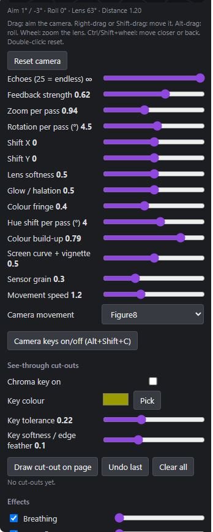
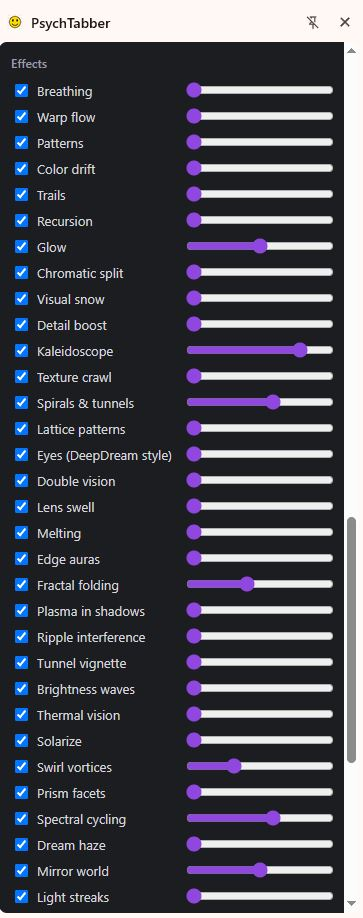
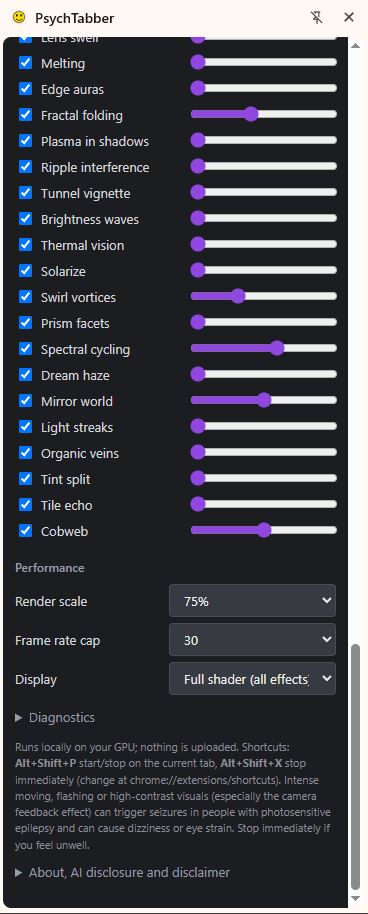
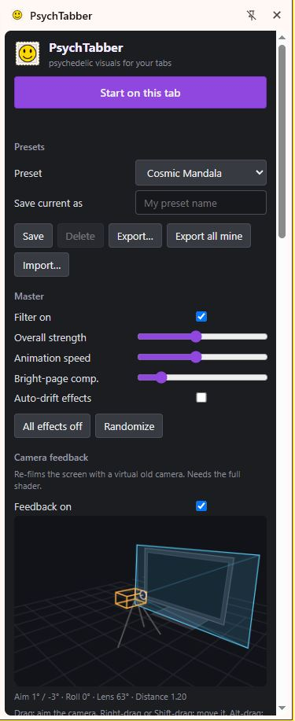

# PsychTabber

> ## 🤖 This entire project was created with AI
> **Everything in this repository was made using artificial intelligence (Anthropic's Claude), directed by a human: all of the code, the shaders, the interface, the icons and other assets, this README, the guides, the descriptions and the legal text.** It has not been professionally reviewed or audited, and the AI can make mistakes. Read the [full disclaimer](DISCLAIMER.md) before using it.
>
> **Provided "as is", with no warranty and no liability. Use at your own risk.**
>
> **Photosensitivity warning:** this extension can produce intense motion, flashing and high-contrast feedback visuals that may trigger seizures or cause dizziness or eye strain. Do not use it if you are sensitive to flashing images, and start with low strength. To stop at any time, press **Start/Stop** at the top of the side panel, click the PsychTabber toolbar icon, or close or reload the tab. Keyboard shortcuts are experimental and may not work on every computer, so do not rely on them.
>
> **Laptops and graphics cards:** it runs on your GPU and is still buggy, so it can use a lot of power, heat up and drain a battery. Lower **Render scale** and **Frame rate cap**, and do not leave it running for long periods.

**Version 1.0 (experimental).** A Chrome (Manifest V3) extension that gives the tab you are on a psychedelic-style look, live and on that tab only, with no extra window. The page stays clickable, scrollable and typeable underneath. It is an artistic filter: it does not simulate any real drug or mental state.

**Guides:** [How to use it](docs/GUIDE.md) · [Every control and effect explained](docs/EFFECTS.md) · [Testing checklist](docs/TESTING.md) · [What each file does](docs/UNDERSTANDING_THE_CODE.md) · [Privacy](docs/PRIVACY.md) · [Disclaimer](DISCLAIMER.md)

## Demo
<!-- DEMO VIDEO GOES HERE. To add it: click the pencil icon to edit this file, drag demo.mp4 into the editor
     right below this comment (free accounts allow up to 10 MB), wait for the link to appear, then commit. -->

## Screenshots
| Top of the panel | Camera and cut-outs | Effects | Performance |
|---|---|---|---|
|  |  |  |  |

Every control is explained in [docs/EFFECTS.md](docs/EFFECTS.md). A drawing of the panel layout is in the [guide](docs/GUIDE.md).

## Features
- 36 visual effects (breathing, warping, kaleidoscope, trails, glow, colour drift, tunnels and more) with 16 built-in presets.
- **Camera feedback loop:** a virtual old video camera re-films the screen, giving ghostly glow, soft edges, colour fringing, hue drift, screen curvature, vignette and grain. Echo count from 2 to endless.
- **3D camera rig in the side panel:** drag a virtual camera around a reference monitor. Aiming, moving, rolling, dollying and zooming the lens drive a real perspective feedback camera. Preset camera moves (handheld, breathe, spiral, orbit, sway, dutch roll, figure-eight, drift) and optional keyboard control (Alt+Shift+C).
- **See-through cut-outs:** chroma-key a colour and/or drag rectangles on the page to make parts transparent so the feedback shows through.
- Save, load, export and import your own presets (JSON).
- Reduced "lite" mode that needs no screen capture.

## Install (developer mode)
1. Download the latest zip from the **Releases** page (or clone this repo) and unzip it.
2. Open `chrome://extensions` and switch on **Developer mode**.
3. Click **Load unpacked** and choose the folder that contains `manifest.json` (the `extension` folder if you downloaded the whole repo).
4. Pin PsychTabber, open a normal `https://` website, and click the icon.

See the [step-by-step guide](docs/GUIDE.md). Requires a recent desktop Chrome (the full shader needs Chrome 132+ for Element Capture).

## Use
1. Click the toolbar icon on a tab. The side panel opens and reduced mode starts.
2. Press the purple **Full shader** button on the page and choose **Share this tab** in Chrome's prompt.
3. Pick a preset (try **Light** first) and adjust sliders. Turn on **Camera feedback** and drag the 3D camera.
4. To stop: press **Start/Stop** in the panel, click the toolbar icon, or close or reload the tab.

Chrome pages, the Web Store and plain `http://` pages cannot be captured.

## How it works
- `engine.js`: WebGL2 renderer with the main effects shader, a ping-pong trail buffer, and the camera-feedback pass (homography from a virtual pinhole camera, multi-tap blur, bloom, chromatic fringe, hue/saturation drift, rounded curved screen mask, vignette, grain, chroma key and rectangle holes, screen-blended with the page, 16-bit float history where supported).
- `content.js`: captures the tab with `getDisplayMedia` and restricts it to the page with Element Capture so the overlay never films itself, then draws a click-through canvas above the page.
- `lite.js`: capture-free fallback using CSS and SVG filters.
- `panel.*`: side panel UI, presets and the 3D camera rig. `background.js`: icon, shortcuts and tab lifecycle. `shared.js`: state and preset helpers.

## Privacy
No data leaves your computer. The code makes no network requests. See [docs/PRIVACY.md](docs/PRIVACY.md).

## Known limitations
- This is an early, experimental release and some features are buggy or may not work. Keyboard shortcuts in particular may not work on every computer.
- Real tab capture varies by site and Chrome version; the Diagnostics box in the panel shows why the full shader failed.
- Heavy on the GPU: lower **Render scale** and **Frame rate cap** on slower machines and laptops.
- The echo count is approximate (it controls how fast echoes fade).
- Not tested on every site, browser or OS.

## AI disclosure
This whole repository, including the code, assets, descriptions and tutorials, was created using AI (Anthropic's Claude) under human direction and lightly tested. Please review the code before trusting it, and report problems through Issues.

## License
Public domain under the [Unlicense](LICENSE). The software is provided "as is" without warranty of any kind. See [DISCLAIMER.md](DISCLAIMER.md) for the full disclaimer, health warning and non-affiliation statement. Not affiliated with Google, Chrome, YouTube or Anthropic.

## Contributing
Issues and pull requests are welcome. By contributing you agree your work is dedicated to the public domain under the Unlicense.
