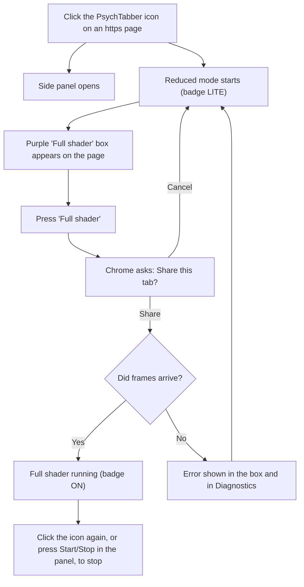
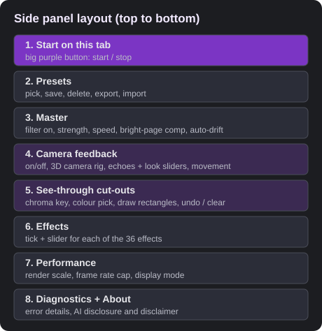
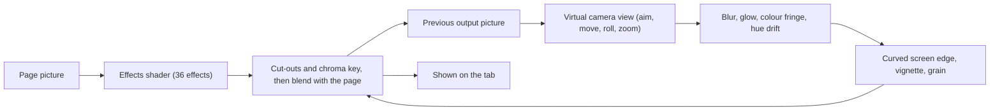
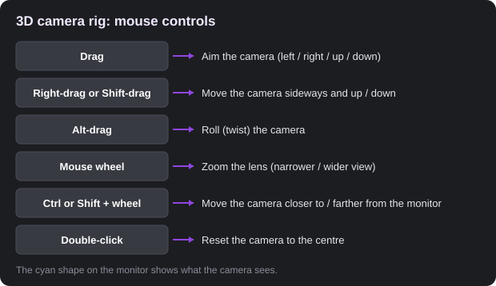
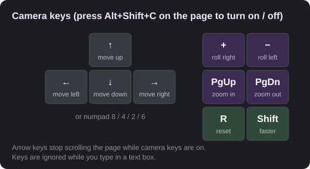
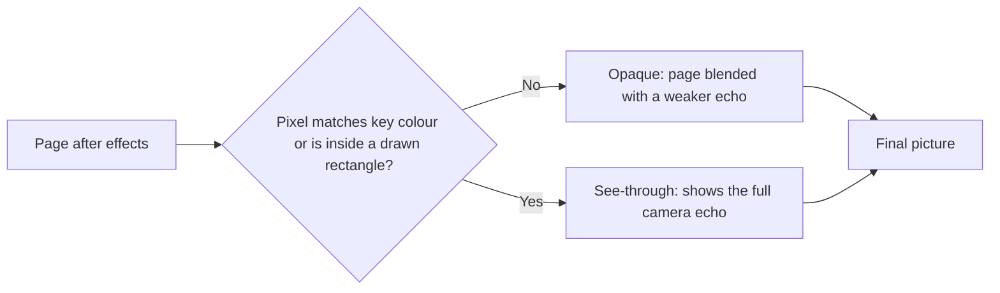
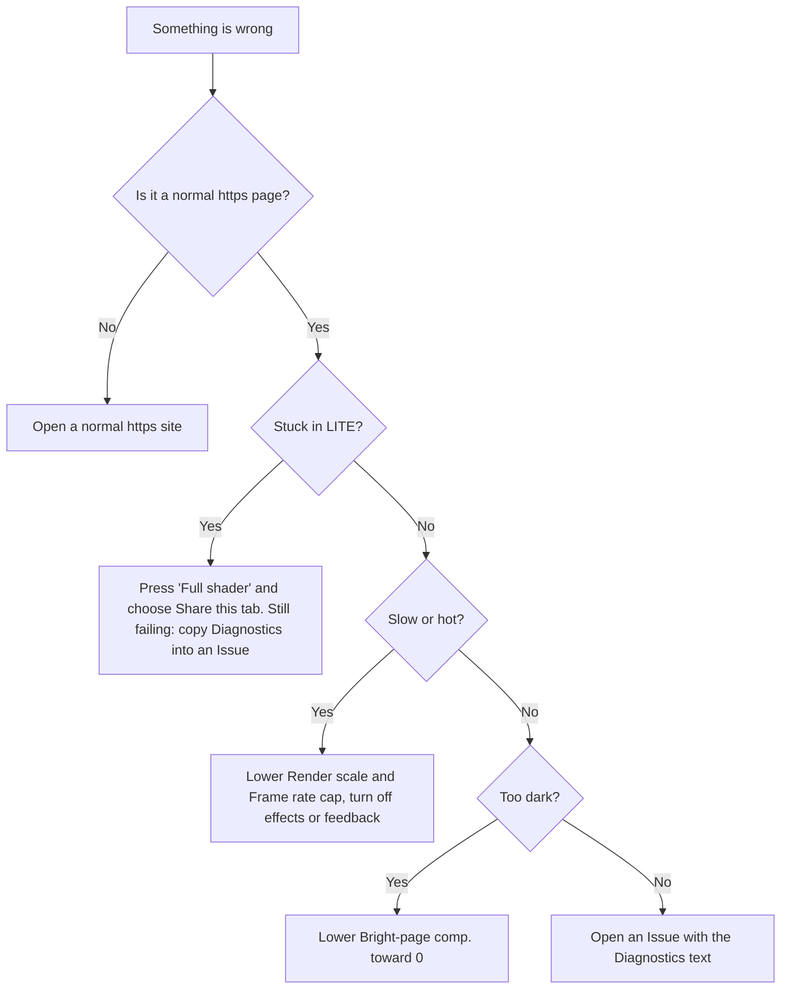

# PsychTabber guide (v1.0)

> This guide was written by AI, like the rest of this project. Details may be wrong or out of date. If something doesn't match what you see, trust what you see. See [DISCLAIMER.md](../DISCLAIMER.md). **Photosensitivity warning:** the visuals can be intense. Stop if you feel unwell. Keyboard shortcuts are experimental and may not work on every computer, so do not rely on them. To stop, press **Start/Stop** in the panel, click the toolbar icon, or close or reload the tab. See [EFFECTS.md](EFFECTS.md) for an explanation of every control.

## 1. Install
1. Download the latest release zip (or the repo) and unzip it.
2. Open `chrome://extensions` in Chrome.
3. Turn on **Developer mode** (top right).
4. Click **Load unpacked** and choose the folder that contains `manifest.json`.
5. Click the puzzle-piece icon and **pin** PsychTabber.

To remove it: `chrome://extensions` > PsychTabber > **Remove**.

## 2. First run
1. Open a normal website that starts with `https://`. (Chrome's own pages, the Web Store and plain `http://` pages are blocked.)
2. Click the PsychTabber icon. The side panel opens and a **reduced mode** starts straight away (badge "LITE").
3. On the page, a purple box appears. Press **Full shader**, then in Chrome's prompt choose **Share this tab**. You will see the full effects (badge "ON").
4. You can keep using the page normally: scroll, click and type.
5. Click the icon again, or press **Start/Stop** in the panel, to turn it off.

If the full shader fails, the purple box shows the reason. Reduced mode stays on. Open **Diagnostics** at the bottom of the panel for details.

## 3. The side panel

Real screenshots and a full explanation of every control are in [EFFECTS.md](EFFECTS.md).

- **Start on this tab:** start or stop on the current tab.
- **Presets:** pick a built-in look. Type a name and press **Save** to keep yours. **Export** and **Import** share presets as files.
- **Master:** *Filter on*, *Overall strength*, *Animation speed*, *Bright-page comp.* (eases white pages down; set to 0 for the original look) and *Auto-drift* (effects wander on their own).
- **Effects:** a tick and a slider for each effect. Start with a few low values and build up.
- **Performance:** *Render scale* and *Frame rate cap* (try **50%** and **24** on a slow computer), and *Display* (full shader or reduced).

## 4. Camera feedback (the "old camera pointed at its own screen" look)
1. Scroll to **Camera feedback** and tick **Feedback on** (needs the full shader).
2. **Echoes** sets how many ghost copies you see, from 2 up to endless (25).
3. Try the sliders: *Feedback strength*, *Lens softness*, *Glow*, *Colour fringe*, *Hue shift per pass*, *Colour build-up*, *Screen curve + vignette*, *Sensor grain*.
4. **Camera movement** picks a preset motion (handheld, breathe, spiral, orbit, sway, dutch roll, figure-eight, drift).

Each frame, the last output is "re-filmed" by the virtual camera and mixed back in. That loop is what creates the echoes and tunnels.

### The 3D camera rig

The panel shows a small 3D scene: a monitor and a camera on a tripod. Moving this camera changes the real effect.
- **Drag:** aim the camera.
- **Right-drag or Shift-drag:** move the camera sideways and up or down.
- **Alt-drag:** roll the camera.
- **Mouse wheel:** zoom the lens.
- **Ctrl or Shift + wheel:** move the camera closer or farther.
- **Double-click** or **Reset camera:** back to the centre.

Tip: if the centre goes black, aim the camera a little off-centre or zoom the lens slightly. A perfectly straight camera re-films its own black hole.

### Camera keys

Press **Alt+Shift+C** on the page to switch camera keys on or off. Then use the arrow keys or numpad 8/4/6/2 to move, **+** and **-** to roll, **PgUp/PgDn** to zoom, **Shift** for faster, and **R** or numpad 5 to reset. While they are on, the arrow keys no longer scroll the page.

## 5. See-through cut-outs
Make parts of the screen transparent so the feedback shows through.
- **Chroma key:** tick *Chroma key on*, pick a colour (the **Pick** button is an eyedropper), then set *tolerance* and *softness*.
- **Draw windows:** press **Draw cut-out on page**, then drag rectangles on the page (up to 6). Right-click removes the last one. Press **Esc** or **Enter** when done. **Undo last** and **Clear all** are in the panel.

## 6. Keyboard shortcuts
Only one is documented: **Alt+Shift+C** switches the camera keys on or off while the page is focused (see above). Other shortcuts are experimental and may not work on every computer, so use the panel button, the toolbar icon or closing the tab to stop.

## 7. Troubleshooting

Details:
- **Nothing happens or "Chrome doesn't allow extensions on this page":** use a normal `https://` site.
- **Stays in LITE:** press the purple **Full shader** button and choose **Share this tab**. If it still fails, copy the Diagnostics text into a GitHub Issue.
- **Laggy or hot computer:** lower *Render scale* and *Frame rate cap*, turn off some effects, or turn off feedback.
- **Page looks too dark:** lower *Bright-page comp.* toward 0.
- **Keys do nothing:** click on the page first, and make sure you are not typing in a text box.
- **Works on one site but not another:** capture varies by site. Please report it in an Issue.

## 8. Safety
Take breaks, keep the strength low at first, and never use it if you are sensitive to flashing images. Stop immediately if you feel unwell. The reliable ways to stop are the panel's Start/Stop button, the toolbar icon, or closing the tab.

## 9. More
- [Every control and effect explained](EFFECTS.md)
- [Testing checklist](TESTING.md)
