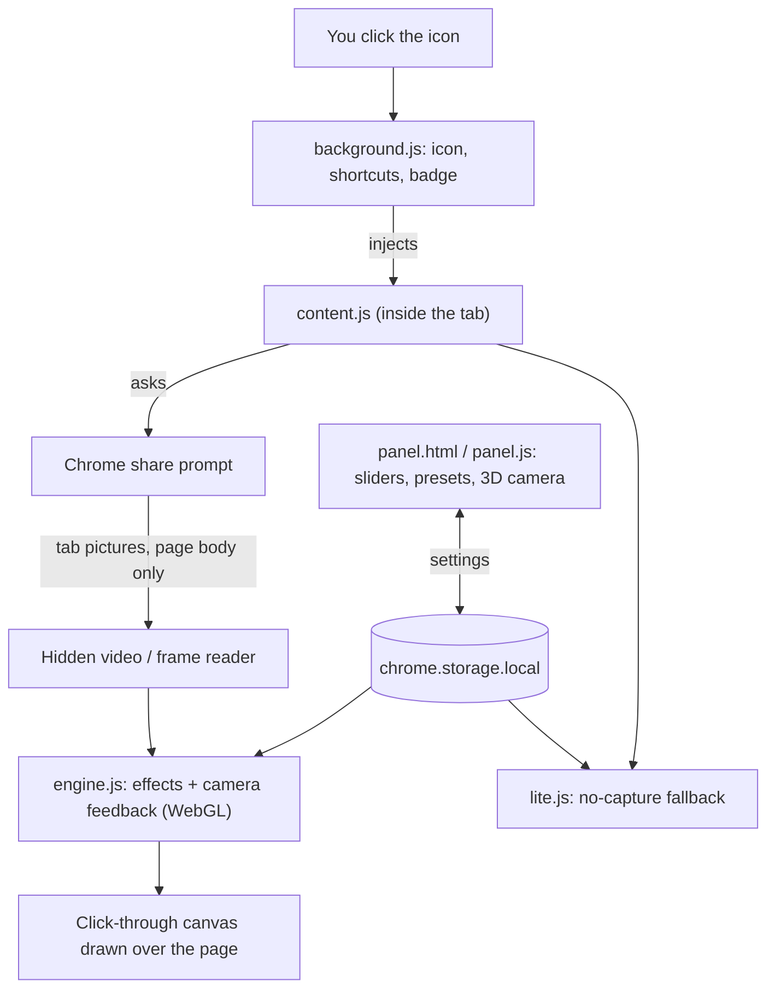
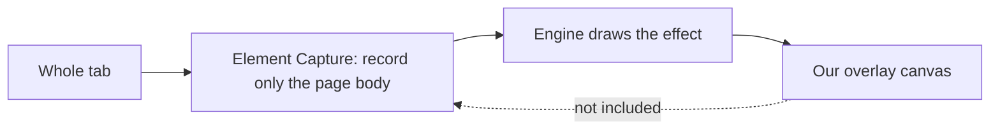

# What each file does (plain English)

Written by AI. No programming knowledge is needed to read this.

| File | What it does |
|---|---|
| `manifest.json` | The extension's ID card: name, version, permissions, shortcuts. |
| `background.js` | Runs in the background. Handles the toolbar icon, shortcuts and the ON/LITE badge. |
| `content.js` | Runs inside the tab. Asks Chrome to share the tab, draws the effect on top, handles camera keys and cut-out drawing. |
| `engine.js` | The graphics engine (WebGL). Contains the effects and the camera feedback. |
| `lite.js` | A simpler no-capture version of the effects. |
| `panel.html / panel.css / panel.js` | The side panel with sliders, presets and the 3D camera. |
| `shared.js` | Settings and preset helpers used by everything else. |
| `icons/` | The extension icons. |

## Big picture

## Why the effect does not film itself

If the overlay were included, it would capture its own picture and create an unwanted loop. Chrome's Element Capture avoids that, and a built-in self-test checks it.

## How the effect works, simply
1. You click the icon. Chrome asks you to share the tab.
2. The extension gets live pictures of the page (only inside your computer).
3. Your graphics card changes each picture with the chosen effects and draws it over the page. The overlay ignores mouse clicks, so the page still works underneath.
4. For feedback, each new picture is mixed with a slightly shifted, blurred, glowing copy of the previous one, like a camera filming its own screen.

## Check it yourself in a minute
Open the `extension` folder in any text editor, or use a terminal there:
- Network use: `grep -rn "fetch\|XMLHttpRequest\|WebSocket\|sendBeacon" .` should find nothing that talks to a website.
- Permissions: open `manifest.json`. You should see only `activeTab`, `scripting`, `storage` and `sidePanel`, and no `host_permissions`.
- Personal data: search for your name, email and file paths.
